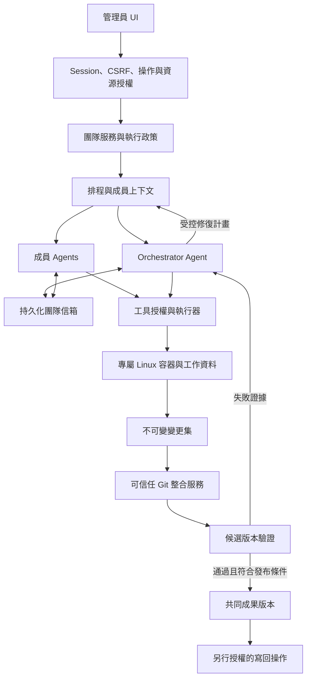

# 多 Agent 協作工作模式實作規格

日期：2026-10-29（Asia/Taipei）。版本：0.3。

狀態：依使用者已確認的方向建立之實作規格，尚未實作或驗收。本文定義實作合約與可設定預設值，不代表已執行環境安裝、資料庫遷移、Git commit、push 或部署。第 16 節的環境輸入須在啟用相依功能前確認。

## 1. 目的、決策與規範用語

使用者可在 UI 建立團隊，指定多位 Agent 的工作職責、個別任務目標與共同驗收條件；成員可互相溝通、並行修改獨立工作副本，在預先授權範圍內自主執行命令與測試，經受控整合後交付結果。

第一階段的產品目標為「單一目標的自主工程閉環」：目標 → 拆解 → 派工 → 執行 → 驗證 → 診斷失敗 → 修正 → 再驗證 → 整合交付。系統必須能在原授權與預算內自行建立修復工作；使用者不需充當訊息轉送者或在每次已知失敗後重新派工。超出權限、需求矛盾、結果未知或無進展時，依本規格等待決策或結束，不能以持續執行取代成功標準。

0.3 修訂範圍：依多位 reviewer 的反例補齊驗證審查、候選修復來源、執行身分、結果確定性、續接與結算協定。原部署、團隊規模、隔離、授權與重啟邊界維持；本次仍只修訂文件。

「必須／不得」為發布條件；「建議」為可替換的實作選擇，替換須保留可驗證的同等保證；「待決策」不得視為已核准。完成文件不代表完成系統。

### 1.1 已確認的產品方向

- 本機部署、單一 admin，保留既有登入與 workspace 資源授權；不新增會員或註冊。
- 第一版團隊 2–4 位成員，包含一位使用者指定的 Orchestrator；沿用服務設定的模型。
- 使用者在開始時預先授權；範圍內命令與測試自主執行，不逐次確認。
- 採目錄責任分工、各自工作副本／worktree、Orchestrator 協調、整合服務合併與候選版本驗證。
- Orchestrator 依驗證證據診斷、重新規劃與派工；已知且可修復的失敗可自主進入下一次嘗試，不擴張目標、成員數、授權或預算。
- Linux 容器提供命令執行隔離；Windows 11 上的 Python 服務維持協調與身分管理。
- 限制互聊、等待與執行預算；服務重啟不自動重跑；停止不回復既有副作用。
- 登出撤銷資料存取，已核准背景工作繼續。

### 1.2 第一版範圍與排除項目

第一版僅支援服務設定的單一 Git repository，以及一個活動團隊工作或既有單 Agent run；團隊內可並行。不開放多團隊同時執行，避免與既有全域執行邊界同時擴大。非 Git 目錄可繼續使用原單 Agent 功能，但團隊模式應顯示不支援原因。

第一版不提供遠端 A2A 成員、Agent 自行新增成員、任意模型／金鑰表單、跨主機調度、自動 push／部署、任意主機命令、Windows 容器、跨重啟自動恢復運算、多租戶、任意網際網路瀏覽或一般目的網域白名單代理。

本階段亦不實作長期專業記憶、工作流模板市場、定時任務、外部事件喚醒、外部 PR／CI 巡檢或常駐雲端電腦。只保留可分離的資料生命週期，不提前建立通用工作流平台。

「10 位 Agent、3 個名額」是擴充時的排程例子，不提高第一版 4 位上限。容器數與成員數不是固定一對一常駐關係；工作狀態必須獨立持久保存。

### 1.3 與既有規格的關係

- [身分與權限需求](security-requirements.md) 為所有新入口的必要條件。
- [既有 UI 規格](ui-implementation-spec.md) 的單 Agent 行為維持；本文僅對團隊模式增加授權、待答、diff 與團隊排程。
- [Web 使用邊界](web-workspace.md) 中單 Agent 不具沙箱的說明仍有效，不得因團隊功能新增容器而宣稱舊入口也受隔離。
- 獨立 CLI／A2A 不由本次服務代理，不沿用其未驗證入口。
- 既有服務只有單一 `_worker`／`_runner`，不得僅移除 busy 檢查後共用同一 runner；須新增團隊排程邊界。

### 1.4 身分、工作與執行生命週期

| 物件 | 第一階段定義 | 不得混同 |
|---|---|---|
| AgentDefinition | 版本化的名稱、職責、指令與技能參照；第一版隨團隊設定保存 | 不含活動 history、容器、憑證或可直接沿用的授權 |
| MemberSnapshot | run 啟動時固定的 AgentDefinition 版本、個別目標、責任範圍與政策參照 | 修改定義不影響既有 run；未來重用定義也必須重新授權 |
| TeamRun / RunAttempt | 一項目標的工作紀錄／一次明確啟動或人工續接期間 | 自主修復不另開 TeamRun 或重設整體預算 |
| WorkItem / WorkAttempt | 要達成的成果與依賴／一次初始或修復嘗試，可包含多個 MemberTurn | 一次驗證失敗不必將整個 WorkItem 判為終態失敗 |
| MemberTurn / Execution | 一次模型回合／一次具體工具或命令操作 | 新修復嘗試不等於重送同一個未知結果的操作 |
| Workspace / Container | 可保存的工作資料／可停止與重建的執行環境 | 容器消失不刪除 Agent 定義、工作證據與歷史 |

第一版不需獨立 Agent 資產庫 UI；建立／編輯團隊時保存 AgentDefinition，啟動時固定 MemberSnapshot 即可。新任務不默認繼承舊任務的上下文或權限。工作歷史與 attempt 結果追加保存，不靠覆寫舊失敗來顯示成功。

## 2. 架構與信任邊界

模型輸出、工具輸出、repo 內容、成員訊息與測試程式均屬不可信資料。Agent 職責 prompt 不是權限政策；工具不能接受模型自稱的身分或任意主機資源 ID。

| 區塊 | 必須負責 | 不得承擔／越界 |
|---|---|---|
| UI | 設定、預先授權摘要、狀態、訊息、diff、成果與控制 | 代替服務端授權、保存密鑰、偽造進度 |
| 團隊服務 | 設定版本、成員歸屬、工作與狀態交易 | 直接依自然語言決定授權 |
| Orchestrator Agent | 工作分解、進展觀察、失敗診斷、修復派工、依賴協調、成果說明 | 擴權、直接發布共同版本、削弱驗收條件、以文字宣告取代驗證 |
| 排程器 | 並行名額、順序、等待、預算、取消 | 自動重跑未知副作用 |
| 訊息服務 | 收件、去重、關聯、可追蹤交付 | 將隊友文字當作 admin 指令 |
| 工作區管理 | 基準快照、版本、各自工作資料、保留與回收 | 覆蓋使用者未提交修改、給 Agent 共用 Git 控制權 |
| 政策／工具層 | 每次操作的能力與資源判定 | 只以工具名稱或 cwd 當隔離 |
| 容器執行器 | 隔離掛載、程序、資源限制、命令結果 | 接受 Agent 指定 Docker flags、主機 mount 或 engine endpoint |
| 整合服務 | 變更範圍驗證、合併、候選版本、發布 CAS | 讓 LLM 直接執行主機 merge shell |
| 驗證服務 | 對確切候選版本執行可信任驗證計畫，保存結構化結果並通知監督流程 | 把 Agent 自報測試成功當作證據、讓模型修改 required gate |
| 儲存／稽核 | 可追溯狀態、事件、快照、必要安全紀錄 | 將憑證、私有推理或任意主機檔案暴露為成果 |

## 3. F1 團隊設定與 UI

### 實作邊界

沿用現有原生 HTML/CSS/JS 工作台、admin session 與輪詢。新增任務的模式選項、團隊設定表單、成員工作視圖、協作訊息、變更與驗證面板；不重寫整個前端，也不新增 SSE／WebSocket。

### 規格標準

- 團隊必填名稱、共同目標、至少一項驗收條件；成員必填名稱、職責、個別目標。成員 ID 由服務端產生，名稱不可作授權識別。
- 成員 2–4 位，恰有一位 Orchestrator；不得從模型文字建立隱藏的額外團隊成員。原生子 Agent 委派須停用或納入相同成員／預算／權限限制，不得繞過名額。
- 可設定目錄責任範圍、工作依賴、預先授權與並行上限；不允許自由輸入主機目錄、映像 URL、Docker 參數、角色或 API key。
- 草稿可編輯；啟動生成不可變設定與政策快照。執行期間修改草稿不改變既有 run；補充目標以新訊息記錄。擴大目標或權限須形成明確的新授權版本。
- 顯示每位成員的排隊、執行、等待隊友、等待使用者、待授權、完成、失敗、停止與中斷狀態。
- 可向整隊或指定成員發送訊息；整隊訊息展開為確定的收件清單。隊友訊息與 user 訊息清楚標示，提供關聯工作與回覆鏈。
- 顯示共同成果版本、變更集基準、檔案 diff、整合衝突、測試平台／狀態；「Agent 回答完成」「驗證通過」「已發布共同成果」「已寫回」必須分開。
- 修復活動顯示原失敗、證據連結、簡短診斷、負責成員、目前嘗試次數與剩餘預算；一般修復不要求使用者按重試。超界顯示明確待決策事項，無進展退出顯示阻礙報告，不以「處理中」無限等待。
- 不展示私有 chain-of-thought；只展示明確訊息、工具結果摘要與可驗證狀態。長內容分頁，使用純文字呈現。
- 375px、768px、桌面可用；鍵盤可操作、44px 觸控目標、文字狀態、不依顏色判讀；輪詢不搶焦點、不清除草稿、不強制捲離閱讀位置。
- 所有 mutation 在收到確認前顯示 pending，未知結果先查原 request，不以新 ID 偷偷重送。登出清除私有畫面並忽略遲到回應。

### 驗收成功條件

AC-01：以 UI 建立三位不同職責的成員、設定共同目標與授權後啟動；重整仍能看見相同設定版本與工作。非法成員數、重複／缺少 Orchestrator、未知欄位由服務端拒絕。

AC-02：瀏覽器驗證成員定向訊息、等待使用者續接、衝突顯示、停止、重載、鍵盤與手機流程；登入失效後無私有資料殘留，沒有 console error。

## 4. F2 預先授權與能力管理

### 實作邊界

admin 核准能力上限；Orchestrator 只能在此上限內分派。後端將政策綁定 `team_run_id/member_id/work_item_id/workspace_id/policy_version`，模型只提供業務參數。成員之間不傳遞可重用憑證。

整合再生成與驗證使用服務產生的 `execution_actor=integration|validation`，綁定 run attempt、candidate、plan、policy 與服務專用 workspace；member 可為空，不能偽裝成成員或由模型自行指定。凡執行候選程式、安裝依賴或生成檔案，仍須進容器、取得同一全隊執行 lease，計入相同時間／資源限制並服從停止與撤權。預授權摘要必須同時涵蓋成員與驗證環境所需能力；可信任服務身分不是執行主機程式的豁免。

### 規格標準

| 能力 | 第一版行為 |
|---|---|
| 讀寫一般工作檔 | 限自己的副本與授權範圍；共同成果唯讀 |
| 執行命令／測試／建置 | UI 明確核准後可在隔離環境自主執行，不逐次確認 |
| 依賴安裝 | 獨立核准，只能影響隔離環境；記錄版本與鎖檔 |
| 網路 | 預設關閉；第一版核准開放時明確標示是一般網路能力，不宣稱細粒度網域限制 |
| 環境變數 | 由服務端核准設定；不繼承完整主機 env；模型金鑰留在協調程序 |
| 發布團隊成果 | 啟動授權包含整合政策，符合驗證 gate 才可自動發布 |
| 寫回使用者目錄 | 獨立核准，綁定確切成果版本與目標基準；預設僅交付成果 |
| Push／部署／主機命令 | 第一版不提供；命令授權不包含這些能力 |

依賴安裝不自動包含網路；網路核准不自動提供主機憑證。若無法技術上達成某種限制，該選項必須不可選，不能只在 prompt 中限制。需企業網域 allowlist 的情境列為後續代理方案，不能用簡單 hostname 檢查宣稱已涵蓋 redirect、DNS 或任意 subprocess。

「依賴安裝」選項具體指允許執行器建立／更新受管理的成員依賴環境；未核准時該環境與系統套件唯讀。任意程式執行加可寫工作目錄，本來就允許執行副本內的程式碼，不能保證阻止所有自行解壓套件或模擬安裝行為。若核准一般網路，更無法只靠工具名稱禁止下載或外部 HTTP 副作用；UI 必須告知此權限組合的實際範圍，不宣稱「允許任意網路但技術上禁止一切 push／部署」。第一版不提供 push／部署整合、不注入相關憑證；要求強制禁止外部副作用時，必須維持離線政策。

目錄「責任範圍」是協作規則：越界修改可保留在私有副本，但提交須協調並取得範圍核准。「強制範圍」是安全規則：秘密檔、服務資料、隊友副本與主機資源不得進入可存取範圍。若強制限制是副本內部分子目錄，須以 OS mount／權限強制實現；僅在 diff 檢查時阻止發布不等於執行期禁止寫入。

所有檔案工具與命令共用政策，涵蓋 Deep Agents 原生工具、自訂 `pi_*`、backend、內部委派與成果匯出；禁止 fallback 到現有主機 `pi_bash`。權限不足產生結構化請求，標記 `waiting_approval`；其餘可執行工作繼續。核准建立新政策版本，舊執行持有的能力不能自行升級。

撤權不同於登出：撤回命令／網路等執行能力時，先阻止新操作並終止不再符合政策的執行環境，再確認撤銷生效。已送出的網路請求或外部副作用不可回復。等待核准不是永久占用執行名額。

### 驗收成功條件

AC-03：預先授權後連續執行多次允許命令無額外確認；未核准依賴安裝／網路／寫回不能執行。篡改 member、policy、workspace、run 或重播失效能力均被拒絕。

AC-04：隊友訊息、repo 檔案或工具輸出要求擴權，不改變實際政策；撤權阻止新操作並確認既有不合規程序停止，其他成員工作可繼續。

## 5. F3 基準、worktree 與目錄責任

### 實作邊界

可信任工作區服務管理 Git 與版本。Agent 執行副本不直接控制使用者 repo 的 `.git`。建議在服務私有資料區建立團隊 repository／worktrees，對容器提供檔案快照或隔離 clone；禁止把整個共同 `.git` 可寫掛載給成員。

### 規格標準

- 啟動前建立基準 manifest：相對路徑、檔案類型、內容 hash、必要 mode 與來源版本；涵蓋選定的已追蹤修改及明確選取的 untracked 檔。
- UI 顯示基準範圍與排除原因；不得只從 HEAD 開始而悄悄漏掉使用者未提交修改。對捕捉期間變動的檔案重驗，無法取得一致快照就要求重試，不宣稱原子快照。
- 預設排除 `.env`、憑證、主機 `.venv`、服務資料、快取與忽略檔；敏感已追蹤檔也不能因 tracked 而自動帶入。使用者必須知道排除可能影響測試。
- 不 stash、reset、commit 或 checkout 使用者工作目錄；內部快照／commit 僅在私有團隊 repo，屬團隊執行授權範圍，不得 push。
- 各成員工作副本從明確基準建立，內容及工作歷史互不覆寫；工具讀寫、搜尋與命令指向同一份副本。
- 責任分工以路徑集合與工作項目表示；多人可讀相同原始碼，跨範圍修改須留下協調紀錄。職責變更不自動放寬強制資源權限。
- 接入隊友成果必須指定不可變版本；不得將隊友正在寫入的目錄即時共享。存在本地修改時先保存變更再三方合併，不直接重設。
- 第一版拒絕 symlink／junction／reparse point、特殊檔案、submodule 與不支援的路徑，提供明確原因；檢查 Windows 大小寫碰撞、保留名稱與跨平台路徑問題。
- 路徑驗證涵蓋正規化、`..`、絕對路徑、連結與檔案型別；匯入匯出不得信任 tar／zip entry。可變目錄匯出前須停止寫入並重新驗證，避免檢查後替換的競態。

### 驗收成功條件

AC-05：包含 dirty tracked 與選定 untracked 的基準可重現；使用者原 repo 的內容、index 與 HEAD 不變。秘密檔及不支援檔案不被帶入。

AC-06：兩位 Agent 同時修改同一相對路徑，各自讀回自己的內容，主機原檔不變；明確接入隊友變更時產生新基準與可追溯紀錄。

## 6. F4 Linux 容器執行器

### 實作邊界

Windows Python 服務執行模型與調度；Docker Desktop Linux engine 提供執行環境。可信任執行器操作 Docker，Agent 不取得 Docker socket、主機 named pipe、engine 憑證或 Docker 管理 API。第一版不提供任何主機命令降級路徑。

### 規格標準

- 啟動前 preflight 檢查 engine 可用、Linux 模式、核准映像、儲存空間與資源設定。失敗時阻止團隊啟動，既有紀錄仍可讀；不自動安裝／啟動／升級 Docker 或 WSL。
- 映像由管理員核准並記錄 digest，建立 Linux Python 環境；不得重用 Windows `.venv`。需要前端測試時提供核准 Node runtime。
- 團隊啟動授權畫面列出實際生效的 CPU、RAM、PID、儲存／監測門檻、同時執行數、網路與時間限制；任何必要限制缺失即拒絕啟動，不採未告知的無上限預設。
- 非 root、非 privileged、移除非必要 capabilities、禁止權限提升、唯讀根檔案系統；僅工作資料與限定暫存可寫，不掛載主機 home、服務資料、共用 Git metadata 或隊友資料。
- 設 CPU、RAM、PID、時間、輸出與儲存限制。若底層無硬性磁碟 quota，必須明示採專用儲存與容量監測／終止，完成耗盡測試前不得宣稱硬上限。
- 不使用 host network、不發布服務 port；離線政策以 engine network 隔離實現。核准網路時不得將其描述為完全阻止主機／LAN 存取；更窄需求須另設 egress 控制並驗證。
- 命令可為 shell script，但只能在已授權容器內執行；控制面參數使用結構化 API 或正確 argv，不把模型文字插入主機 shell。
- 命令結果含 command ID、attempt、工作副本版本、映像 digest、時間、exit code、是否 timeout／cancel／OOM、遮蔽後輸出與截斷標記。exit code 0 不自動代表任務完成。
- 容器按需建立；同成員同工作可重用，不能每個工具呼叫重建。閒置可停止，工作資料獨立保存。不同成員不得接手未清理的容器、程序或秘密。
- 「停止」可由可信任服務停止／強制終止專屬容器；確認程序結束前不釋放執行名額。若 engine 無回應，標記清理未確認並阻止重用，不能顯示已安全停止。
- 等待隊友前必須結束或暫停受管理的執行工作；背景子程序仍在跑就仍占用名額。禁止將 shell 背景程序留在未計量的閒置容器。
- 網路、安裝與容器內程序產生的副作用不因回復 Git 版本而撤銷。容器不是絕對安全保證，也不保證辨識所有秘密。

### 驗收成功條件

AC-07：真實 Linux 容器內完成 Python 命令、測試與工具讀寫，讀寫與測試命中同一副本；不存在 host fallback。映像、command、exit code 可追溯。

AC-08：測試讀寫主機 sentinel、隊友資料、服務 DB、Docker socket、路徑穿越與連結攻擊均失敗；未核准網路不能連線。命令與自訂工具不能繞過相同限制。

AC-09：真實驗證 timeout、子程序、OOM／PID 限制、輸出截斷、停止與 engine 中斷；停止確認前名額不被重用，失敗不污染其他成員資料。

## 7. F5 成員上下文、排程與預算

### 實作邊界

沿用 Deep Agents 模型、摘要、工具配對與公開擴充點；新增團隊層，不重寫模型 loop。每成員有獨立上下文與 framework thread／state 身分。協調模型留在主機，但所有可操作工具均須導向受控資源。

### 規格標準

- 實作前核對實際安裝版本。本次調查為 Deep Agents 0.7.10；一般 `task` 子 Agent 是一次性委派，不能直接假定提供持久隊友信箱。官方 async subagents 是替代路徑，但增加 Agent Protocol server 須另評估。
- 先確認公開 backend、middleware、checkpointer 與 compiled agent 擴充點可滿足隔離、歷史、摘要及取消。若需新套件或替換核心機制，先提出證據與調整計畫。
- 同成員同時最多一個 turn；以原子 claim／租約防止重複排程。不同成員按資源與依賴並行，不能共用可變 history。
- 分別管理模型呼叫名額與容器執行名額；預設模型並行 1、容器執行並行 2，可在團隊大小與主機上限內調整。不得為 4 位成員預設建立 4 個常駐執行程序。
- 第一版同時只執行一個頂層工作；舊單 Agent 與團隊互斥。接受工作前保留名額，拒絕競態啟動。
- 等待隊友／使用者／授權時釋放可釋放名額；排程採 FIFO 並避免單一成員飢餓。收到訊息喚醒下一輪，不在模型呼叫中任意改寫 history。
- 明確等待依賴形成環時記錄 deadlock 並交 Orchestrator；無法處理轉使用者。等待逾時與無進展預算由程式觸發，不只靠模型判斷。
- 可設定的初始限制：團隊 wall time 60 分鐘、每 turn 10 分鐘、每命令 120 秒、全隊模型呼叫 100 次、成員訊息總數 200、連續無可驗證進展 10 次交付、等待隊友 5 分鐘。待使用者時間仍計入 wall time，超限保存並終止本次 run，不自動重啟。
- 可驗證進展包括新增必要證據、解決失敗檢查或阻礙；合法狀態轉移、新變更集與新驗證結果只作觀察事件，不自動重置無進展計數。同內容換 hash、相同失敗重跑、互傳文字與重新命名工作均不算進展。摘要等內部模型呼叫也納入可觀測呼叫預算。
- 預算與實際使用量持久化；provider 不回報 token 時顯示未知，不偽造費用硬上限。時間、呼叫、訊息及資源限制仍必須有效。
- 重啟後舊 attempt 已消耗的額度不能因 retry 歸零；延長總預算需 admin 明確核准。限制計數與派工保留額度須原子更新，避免並行超額。
- 每位成員保留必要框架狀態、已完成工具結果與原生摘要參照；不以重新送出所有 user 文字來假裝精確恢復。重啟後只能明確建立新的 attempt，未知工具不自動重播。

### 7.1 自主監督、修復與退出協定

本節的 unknown 專指操作結果不確定。`result_certainty=known|unknown` 與 `failure_class` 分開保存；已取得可信任執行結果但無法辨識原因，記 `known + unclassified_failure`，可在預算內診斷修復。沒有取得完成證據則記 unknown，先對帳，不以錯誤分類或模型判斷推定未執行。

Orchestrator 接收工作／工具完成、驗證失敗、整合衝突、等待逾時與無進展事件，觀察證據並提出結構化決策。第一版使用服務內持久化事件佇列及既有 timeout，不新增外部排程平台，也不需要持續呼叫模型輪詢。

| 已觀察情況 | 必須採取的行為 |
|---|---|
| 已知程式缺陷／候選驗證失敗 | 在原範圍內提出修復計畫，建立新 WorkAttempt 或關聯修復 WorkItem |
| 已知合併衝突 | 指派既有成員在處理副本修正，重新提交與驗證 |
| 已知環境缺失且修復能力已核准 | 在隔離環境修復後重新驗證；不得自行安裝主機元件 |
| 需要新增權限、改變需求或驗收標準 | 受影響工作 waiting_approval／waiting_user，其餘無依賴工作繼續 |
| 操作結果 unknown、程序停止未確認 | 先唯讀對帳；未證實可安全繼續前禁止相關重送／修復派工 |
| 相同失敗反覆出現、無進展或修復預算耗盡 | 停止該修復鏈並保存阻礙報告，不自動換工作 ID 重置額度 |
| 團隊停止、全域預算耗盡或服務重啟 | 停止新修復派工，沿用 F10 的停止／中斷與人工續接規則 |

每個修復計畫必須保存：原 WorkItem／WorkAttempt、failure event／validation ID、候選與基準版本、實際症狀及證據、簡短診斷與不確定性、與前次嘗試不同的處理策略、負責成員、允許修改範圍、修復後必須重驗項目及預算。只提供「再試一次」而無理由的計畫不被接受。無程式變更的環境修復仍須綁定原候選與新的環境／驗證紀錄。

服務端驗證計畫的身分、範圍、版本、必要 gate、依賴及預算後才派工；模型可建議分類但不能自行認定 unknown 已安全或取消驗證要求。工作內的修復不得放寬目標、把必要工作改 optional、刪除 required gate、停用／削弱必要測試來換取通過。合理的測試變更須保存依據並經既定審查；變更驗收基準須由 admin 明確核准。

可設定的初始修復門檻：每個邏輯工作最多 3 次自動修復，不含初始嘗試；相同 failure fingerprint 連續 2 次修復後仍無可驗證進展就退出。fingerprint 由服務以檢查 ID、失敗類別與正規化症狀產生，排除時間戳／隨機路徑；未知格式保留原證據並以一般無進展與次數上限保護，不憑模型宣稱兩次失敗不同就重置。子修復工作、重新派給另一成員與拆分工作共用原 repair root 的額度，且所有修復仍消耗 F5 全隊預算。

修復派工以 `run_attempt_id + failure_event_id + repair_generation` 唯一鍵去重；事件、排程 intent、修復額度保留在同一交易保存。重複通知只能產生一個修復嘗試。晚到的舊候選失敗若已被新版取代，只補歷史，不得把已完成工作喚醒成新修復。

同一 repair root 同時最多一個活動修復 generation；成員回報與驗證事件即使 ID 不同，只要指向相同候選／檢查與未解決失敗，就合併證據至目前 generation，不另派一輪。generation 由服務端產生，模型不能遞增它以繞過去重。修復嘗試終止後才可依新證據進入下一代。

修復鏈退出時，保留嘗試摘要、最後失敗、已排除事項、未確認原因、成果／diff、剩餘或耗盡預算與需要使用者決定的項目。停止修復鏈不立即取消其他獨立工作；必要工作最終失敗仍阻止團隊 completed。全域預算耗盡則停止整隊。新授權或人工續接不能抹除先前消耗與失敗紀錄。

AC-21：首次整合驗證因實際缺陷失敗後，證據自動送達 Orchestrator，成員依修復計畫改正，產生新候選並重驗通過後交付；原授權內無使用者重新派工或逐次確認，原失敗與新成功都可查。

AC-22：相同失敗、無進展及修復額度耗盡分別觸發預期退出，產生可操作阻礙報告；換成員、子工作、取消重建 lineage 或替換來源 root 不能重置修復額度，多 root 修復不能放寬任一限制，無額外未授權操作。

AC-23：修復需要新權限時只阻擋該工作與其依賴，獨立工作仍可完成；unknown 副作用不被自動重播。停止／撤權後晚到的修復決策不能派工。

AC-24：重複失敗事件、同時收到驗證通知與成員回報、以及已被取代候選的晚到失敗，不產生重複或過期修復；企圖跳過 required gate／削弱驗收的決策被拒絕並記錄。

AC-25：修改 AgentDefinition 不改變活動 MemberSnapshot；新任務不帶入舊 history／權限；一個 WorkItem 可有失敗再成功的不同 WorkAttempt，舊結果不變；停止或重建容器仍保留全部定義與證據。

### 驗收成功條件

AC-10：以三位成員及容器上限 2 測試同時執行數、同成員串行、排隊公平性與等待釋放；忙碌容器不得以 waiting 狀態逃避限制。

AC-11：注入互等、無限互聊與預算耗盡；在設定門檻停止派工並保留原因。摘要確實產生、歷史可回查、工具不重複執行、內部摘要不混入對外回答。

### 7.2 框架與儲存整合合約

每位成員使用獨立 graph 與 thread namespace；透過 `create_deep_agent` 公開的 backend、middleware、checkpointer 擴充點接入。團隊 factory 不使用現有 `_HistoryGraph` 的純文字 history 重建。SandboxBackendProtocol adapter 經可信任執行器存取同一成員 Linux 副本，所有原生／自訂檔案與命令工具必須走該邊界；禁用主機 `pi_*` 工具並提供相同業務能力的容器工具。

使用 CompositeBackend 的保留路由將原生摘要歷史與大型工具輸出保存至成員私有持久儲存，與可提交的 repo 分開；保留路由不允許一般寫入工具覆寫。框架可在受控內部上下文寫入，成員只能讀取自己的必要歷史；不得將這些資料自動納入 diff、候選或公開附件。容器被移除後，原生摘要參照仍可解析。

持久化 adapter 遵循已安裝 LangGraph 的公開 BaseCheckpointSaver 合約，含 checkpoint、channel versions、pending writes 與所使用的同步／非同步方法；採既有 SQLite 與標準庫，不假定現成 SqliteSaver 已安裝。保留原生摘要與工具配對修補流程，不自行改寫摘要演算法。正常 turn 從已完成安全邊界續接；服務重啟後只讀取舊 checkpoint 作對帳與歷史，建立新 thread／attempt，不能直接 resume 含未決工具的執行點。已確認完成的工具結果保留，未確定者明確記 unknown，不能偽造成功結果來補配對。

以每個 graph 的公開 middleware 隱藏並拒絕原生 `task`／非核准 async 委派工具（包含直接或偽造 tool call），不修改全域 profile 影響既有單 Agent。所有模型呼叫包括摘要均經共用預算入口。M0 必須用真實 graph 驗證以上能力；若公開合約存在差異，先提出具體失敗證據與相容方案，不靜默換框架。

## 8. F6 成員訊息與工作協定

### 規格標準

- `send_message` 僅允許同一 team run 的有效成員；sender 由執行上下文綁定。預設可定向送給任一隊友，不必由 Orchestrator 轉述。
- 訊息含 ID、sender、recipient、work item、reply_to、種類、正文、成果版本參照與時間。種類為 question、answer、handoff、finding、status；不得攜帶權限更新。
- 先持久化再回 accepted；分清 accepted、delivered、processed。投遞採可重送加去重，不宣稱任意工具副作用 exactly-once。
- 每輪原子領取明確訊息批次，按成員序號處理；處理成功才標 processed。崩潰後對未知是否生效的 turn 標中斷，不以訊息未完成為由自動重執行。
- 同 request ID 同內容回原結果；不同內容重用 ID 回 409。廣播展開的收件者與各自狀態持久化，避免重送重複喚醒。
- 單則訊息上限 32,000 字元；正文與成果均視為資料，不提高優先序或權限。訊息數超限拒絕新送出並觸發預算處理。
- 新訊息到達正在執行的成員時排隊；該成員準備完成時須檢查未處理的相關訊息，不可遺漏關鍵交接。
- `request_user_input` 綁定明確 question ID 與目標工作；UI 回答回到原成員，不讓模型猜收件人。重複回答去重，過期問題回 409。

### 驗收成功條件

AC-12：驗證者直接指出實作者缺陷，實作者收到後修改、回覆並再次提交；完整鏈可查。跨團隊、偽造 sender、重複投遞、執行中到達與過期回答均有確定結果。

## 9. F7 變更集、合併與共同成果

### 實作邊界

Orchestrator 決定協作順序、提出衝突處理工作；可信任整合服務執行 Git 與發布。Agent 無權直接寫共同成果分支或改變發布 gate。內部版本不等於使用者 repo commit。

### 規格標準

- 變更集保存 author、work item、base version、內容 hash、檔案操作清單、依賴變更集與驗證參照。提交後不可變，後續修正建立新版本。
- 收集時凍結副本寫入並驗證檔案型別、路徑、大小與秘密排除；禁止漏收仍在背景修改中的資料。沒有變更的工作仍可提交文字證據。
- 提交檢查授權範圍、責任範圍例外核准、基準歸屬與檔案政策；刪除、改名與 mode 變更不可只當一般文字 diff。
- 以 base、proposal、current 進行三方合併；不採 last-writer-wins。不同區段可嘗試自動合併，同區段／刪改／改名碰撞進 conflict。
- conflict 保存所有版本並交原成員或指定成員在處理副本修正；不得直接請模型回傳一段文字後覆蓋共同成果。
- lockfile／生成檔優先依合併後來源與核准生成命令重建。二進位及不可合併檔須明確解決，不任意選一方。
- 建立不可變候選版本，記錄候選 hash 與目前共同基準，執行 F8 gate。可並行準備候選，但共同版本發布必須序列化。
- 發布使用 compare-and-swap：基準、候選 hash、驗證計畫與政策版本都須匹配。基準已變、撤權或停止時拒絕發布；重新合併並驗證。
- Git 操作不使用 repo 自帶 hooks／任意設定執行主機程式，禁用外部 diff、filter、hook 等非必要執行路徑；所有程式化驗證在隔離環境。
- 每次發布保留前後版本與證據；回復共同成果也產生新版本，不重寫稽核歷史。回復不等於撤回外部副作用。

### 9.1 未發布候選的修復與來源歸屬

Candidate 保存 `integration_base`、來源 change IDs、內容 hash、驗證計畫與 lineage。若共同版本 C 合併 A、B 得到尚未發布的 F，修復者以 F 作 `checkout_base` 產生 R；R 的 `publication_base` 仍是 C。服務將 R 視為包含 A、B 與修復的替代提案，以 C／R／最新共同版本三方合併，不得以 F／R／C 合併而遺失 A、B。

同一來源變更集只可被一條活動 integration lineage claim；其他含相同來源的整合須排隊。claim 與候選建立為原子交易，修復代際承接 claim；取消／失敗終止 lineage 才釋放，保留原變更。發布 CAS 成功時，原子記錄完整來源集合與修復的納入關係並將來源標 integrated。無交集候選可並行準備；共同基準推進後，舊候選須重合併與重驗，不能重複納入已整合來源。驗證報告綁 candidate 及全部來源 work attempts；Orchestrator 指定一個責任 repair root 協調修復，不對每個來源自動重複派工。

Orchestrator 對責任 root 的指定只是首次建議，服務將未解決失敗、來源工作的 lineage 與 repair roots 持久綁定；後續不得換 root 取得新額度。替代候選、來源變更重新提交、取消後重建 lineage 均承接既有 failure／root 關係。修復涉及多個既有 root 時，為每個受影響 root 原子保留一次修復額度，任一耗盡就不能派工；不將其合併成額度較寬的新 root。服務依來源關係與 fingerprint 查找原失敗，不只信任模型提供的 ID；無法確定歸屬時先診斷，不先發放新修復額度。

### 驗收成功條件

AC-13：兩位成員從相同基準修改不同檔案，可依序整合；修改相同區段被阻止且雙方內容保留；涵蓋刪改、改名、二進位與 Windows 大小寫碰撞。

AC-14：驗證完成後故意推進共同基準、改變政策或停止 run，舊候選不得發布。整合操作失敗／重啟可對帳，不重複發布或宣稱成功。

## 10. F8 驗證 gate 與 CI

### 實作邊界

第一版的「CI 驗證」指本機自動化的候選版本驗證 gate，不預設更改 GitHub Actions、push 到遠端或購買 CI 服務。若採外部 CI，須另行確認整合與外部副作用。

### 規格標準

- admin 預先核准驗證計畫：命令、平台、必須通過項目、timeout 與需要的資源。計畫由可信任服務保存，Agent 修改 repo 內設定不能默默關閉必要 gate。
- Agent 自行跑的測試屬開發證據；整合 gate 必須重新對確切候選 hash 執行，不能重用另一個版本的 pass。
- 驗證從乾淨候選副本開始，使用核准映像與固定依賴來源；Agent 修改過的 venv、測試快取或工具不能直接充當可信任驗證環境。
- 記錄候選 hash、平台、Python／Node／工具版本、映像 digest、計畫 hash、命令、exit code、日誌、開始結束時間與 skip 原因。輸出需遮蔽、截斷與安全保存。
- skipped、timeout、環境失敗與 failed 分開；任一 required gate 非 passed 就不得發布。測試不存在不得以空執行偽造通過。
- 每個結果輸出結構化報告：validation ID、run attempt、來源 work attempts、候選與計畫 hash、check ID、平台／環境識別、status、錯誤類別、原始證據參照與安全摘要、exit code、timeout／OOM／取消標記、result_certainty。failure_class 包含 code_failure、environment_failure、policy_blocked、timeout、cancelled、unclassified_failure；結果不確定時 certainty=unknown，分類可為空。分類未知不等於操作結果未知，依 7.1 處理。
- 驗證結果與通知 intent 同一交易保存，由 F5 的監督流程消費；失敗不只顯示紅色狀態。可修復結果建立修復計畫，不可修復／超界結果轉待決策或明確退出。取消不觸發自動修復，舊 run attempt 的通知不得啟動新 attempt。
- 修復後重新以新候選執行必要 gate；僅修復環境時候選 hash 可不變，但須新增環境紀錄與 Validation。不得覆寫失敗報告或把修復期間的開發測試當成整合 gate。
- 測試、驗證設定與 lockfile 變更需明確列入審查。通過測試不能證明完整正確，仍需檢視語意衝突與測試被削弱的風險。
- Linux gate 不代表 Windows 通過。平台要求由計畫明示；若成果要求 Windows 相容，須有該候選的 Windows 驗證證據才能標示該平台已驗證。
- 第一版不讓 Agent 自主在 Windows 主機執行候選程式。Windows 證據可由管理員明確執行並附版本／命令紀錄，標為人工證據；若 Windows 為 required 且尚未提供，維持待驗證。
- 本協作功能本身發布前，仍須在 Windows 跑既有與新增 Python／前端測試，並跑真實 Linux 容器驗收；不能僅以 mock Docker 測試代替。

### 驗收成功條件

AC-15：A 與 B 各自測試通過、合併後破壞 API 的案例必須被整合測試抓出並阻止發布。以錯誤版本、過期計畫或 skipped 冒充 pass 均失敗。

AC-16：報告分別列出離線可控模型、真實容器、真實模型及 Windows／Linux 驗證；缺少任何 required 證據時 UI 不顯示全部通過。

### 10.1 驗證資產、審查與環境修復

啟動計畫固定 required checks、服務控制的執行入口、測試／runner／設定／驗證依賴的 protected manifest，以及最低 collection／必要 test IDs 等適用條件。服務以自己的程序結果、收集紀錄與報告解析器判定 check，不只信任候選輸出的「passed」。候選新增測試可作補充證據，不能自動替代原 required checks。

protected manifest 同時保存既存資產 hash 與新增／改名路徑的保護規則；新建 conftest、pytest plugin、測試啟動設定或 package config 亦須命中審查，不能僅比對基準已有的檔名。計畫必須列出會被 runner 載入的控制入口與其規則，不允許候選自行指定新的外部驗證入口。

受保護資產的任何修改（含刪除 assertion、skip、pytest plugin／conftest、package script、lockfile 與驗證依賴）產生 ReviewRecord，狀態 pending／approved／rejected／superseded。指定既有成員可提交 review 建議，最終變更必要驗證資產或驗收基準由 admin 核准，綁定 candidate hash、diff hash、原 plan hash 與審查理由。原核准資產仍適用時，可繼續以其唯讀副本測試候選；涉及受保護修改的候選在核准前不得發布，不能用通過舊 gate 繞過審查。一般產品程式修復與未受保護的新增測試仍按預授權自主進行。

核准建立新驗證計畫版本並重驗所有 required checks；不得回填舊 pass。protected manifest 是可執行的變更審查邊界，不能保證測試涵蓋完整或所有語意未弱化；審查須檢視測試收集與必要行為，未確認時轉待決策。AC-24 檢驗拒絕未核准替換與跳過，不宣稱可自動證明任意測試等價。

環境修復必須產生可重建的 EnvironmentSpec（核准映像 digest、工具／依賴版本及 lock hash、來源、安裝命令與能力需求），不能僅修改成員 venv。驗證服務依此在新隔離環境重建，記錄 environment hash；涉及 protected 依賴／計畫變更走上述審查，其餘已核准範圍內的環境重建可自主執行。重建仍需相同全隊 lease，網路／安裝未授權則等待核准。

### 10.2 人工平台證據

required Windows check 建立 pending manual-validation request，UI 提供版本下載、待執行命令與提交欄位。admin 提交 run attempt、request ID、candidate hash、plan hash、check ID、平台／工具版本、實際命令、結果、執行時間、日誌與附件 hash；服務確認 request 未過期、版本及 membership 一致，保存 `source=admin_manual` 與 actor。文字聊天或 Agent 自報不能代替該紀錄；標示為人工聲明及證據，不宣稱服務已自行執行或能驗證聲明真實性。缺件或 failed 不解除 required gate，過期候選／計畫回 409。附件以受保護上傳入口保存，不接受任意主機路徑。

## 11. F9 交付、寫回與資源回收

- 團隊成果為不可變版本、變更說明、diff／patch、檔案成果與驗證報告；下載使用不透明 ID 並驗 membership，不提供任意路徑讀取。
- 發布團隊版本不自動寫回使用者原目錄。寫回需獨立核准，綁定 source version、target base manifest、操作清單與 request ID。
- 寫回前檢查受影響路徑仍等於預期基準；使用者新增修改時返回 conflict，保留雙方內容。檢查與寫入間仍須協調排他存取，不能把逐檔 hash 檢查宣稱為跨檔原子交易。
- 第一版若無法取得使用者目錄的可靠獨占窗口，僅提供 patch／成果下載，禁止自動寫回。不能用應用內鎖假設外部編輯器也遵守。
- 若啟用寫回，須有寫前備份、操作 journal、逐步結果與失敗復原流程；中斷時標記待對帳，不假裝全有或全無，也不回復覆蓋使用者後來的修改。
- 清理僅操作服務登記且已驗證位於專用根目錄的資源；須確認無 active lease、成果已保存、無待對帳操作。
- 停止容器不刪工作 volume；刪除容器、工作資料、訊息與成果是不同操作。團隊未完成或失敗資料不自動刪除，完成後由 admin 明確清理；不設定未告知的自動保留期限。
- 封存團隊為唯讀；永久刪除須確認，不能刪使用者原始工作目錄。DB／檔案分階段清理有 journal，可重試但不重跑任務。

archive 僅允許沒有活動、unknown、待對帳 run／ApplyJob 的團隊，否則 409；封存不隱含 stop。封存後保留授權讀取、restore 與明確清理／purge，拒絕其他 mutation。restore 只恢復定義可編輯，不自動續跑。

AC-17：寫回時外部修改受影響檔案必須被保留；未取得可靠獨占條件則停在 patch 交付。清理重試、部分失敗與路徑偽造不刪錯資料。

## 12. F10 狀態、停止與故障恢復

### 12.1 狀態合約

| 物件 | 狀態與語意 |
|---|---|
| Team definition | draft、archived；每次啟動建立獨立 run 與設定快照 |
| Team run / RunAttempt | queued → running → completed／failed；running → stopping → stopped；服務重啟未終止工作 → interrupted。TeamRun 表示目前整體狀態，RunAttempt 保存各次啟動／人工續接的不可覆寫終態 |
| Work item | pending、ready、running、waiting_peer、waiting_user、waiting_approval、submitted、verifying、repair_pending、completed、failed、cancelled、interrupted |
| Work attempt | queued、running、submitted、verifying、succeeded、failed、cancelled、interrupted；終態不可改寫，修復建立新 attempt |
| Member turn | queued、running、completed、failed、cancelled、interrupted；wait 是工作狀態而非無限執行的 turn |
| Change set | submitted、scope_blocked、conflict、validating、validation_failed、ready、integrated、superseded、cancelled |
| Execution | queued、starting、running、stopping、succeeded、failed、cancelled、unknown |

queued run 在沒有啟動 intent／活動資源時可原子轉 stopped；已保留啟動 intent 則先轉 stopping 並對帳。停止與 start claim 使用相同 revision／CAS，停止先取得交易時不得啟動。全域失敗或預算耗盡亦先關閉派工／發布入口，進 stopping 並記錄 `terminal_intent=failed`；確認資源排空後才落 failed，使用者停止則 terminal_intent=stopped。unknown 未清理前停留 stopping／interrupted 並顯示原因，不能先宣告終止再放任新工具執行。

所有轉移由服務端檢查前置狀態與 revision。工作依賴為 DAG，建立／更新時拒絕環；聊天形成的動態等待環另由排程處理。failed 的必要工作阻止團隊完成，Orchestrator 不得自行把必要工作標 optional。

已知且允許修復的驗證失敗將當次 WorkAttempt 記 failed，原 WorkItem 由 verifying 轉 repair_pending；新計畫通過服務檢查後建立新 WorkAttempt，再轉 ready／running。只有修復不可行或額度耗盡才將原 WorkItem 記 failed，不能第一次測試失敗就強制整隊終止。若需要新增修復 WorkItem，以 `repairs_work_item_id`／`repair_root_id` 記錄來源；這是追溯關係，不反向加入 DAG 的阻塞邊造成環。原工作等待修復成果，服務驗證證據後再轉完成。

已完成工作若因後續整合發現新問題，追加關聯修復工作，不改寫原 attempt；該問題未解決前阻止整體 completed。Orchestrator 可重排未完成工作的依賴，但更新須通過 DAG、範圍與 revision 檢查，不可略過必要成果。

多來源候選失敗只將尚在 submitted／verifying 的相關 WorkAttempt 記 failed；已 succeeded 的歷史保持原樣，以關聯修復工作承接問題。WorkAttempt 的 succeeded 表示其宣告成果已驗證並在適用時納入共同版本，不代表之後整合永遠不會揭露缺陷。文字成果須有明確 check 或人工驗收，不能跳過證據要求。

團隊 completed 必須同時滿足：必要工作完成、必要驗收條件具證據、待處理的重要問題已解決、必要變更已整合、required gate 通過、無活動／未知執行。沒有程式修改的工作可按明確的非程式驗收交付。成果摘要由 Orchestrator 撰寫，狀態由服務判定。

完成結算與接受訊息／新工作共用 run revision 與交易屏障：服務先確認無 queued/running turn、待消費失敗事件、未結案問題／審查及已接受而未處理的訊息，再 CAS completed 並關閉該 attempt 的新派工入口。訊息先提交則必須處理後才可完成；完成先提交則新訊息回 409，不接受後遺失。成員顯示的完成只代表目前已分派工作結束，run 結算前收到合法新工作仍可再次排隊。所有必要 criteria 必須綁定 check／成果證據或 admin 驗收 request，不能只靠 Orchestrator 自評。

### 12.2 續接、預算與人工決策

人工答案／核准恢復等待中的同一 WorkAttempt，不建立 RunAttempt。continue 僅適用 failed／interrupted／stopped、且無活動或未知副作用的 run；拒絕 completed、未清理完畢與 archived。對帳紀錄必須列明每個未決 operation 的已知結果或無法證實結果時的人工處置與風險接受；不得將人工核准描述成證明副作用未發生。無法確認程序已停止的 execution 不可由核准解除名額。

continue 建立新 RunAttempt，只為未完成必要工作建立新 WorkAttempt；保留已完成成果與修復 root 累積計數。舊 queued 工作、問題、能力與通知均失效；未解決問題以新的 request ID 明確重建，不能用舊回答喚醒新 attempt。讀取舊歷史不重執行工具。

WorkItem 是目前成果狀態，人工續接可將 failed／cancelled／interrupted 的必要項目轉 pending；不可改寫任何舊 WorkAttempt 終態。成果等待人工審查／驗收時，工作顯示 waiting_user，WorkAttempt 保持 verifying；不另創未定義狀態。必要項目確定失敗後，其依賴項以 dependency_failed 取消，獨立工作可繼續；當無可執行或待決策工作且必要成果不滿足時，TeamRun／RunAttempt 依停止屏障收斂至 failed，不無限保持 running。

預算使用量累積於 TeamRun，wall time 為每次 RunAttempt 從開始至終態的時間總和（含該 attempt 的待答時間），終態至人工續接的間隔不計。達限即停止派工並收斂為 failed，仍在停止／unknown 的資源保留其名額；使用量不因續接歸零。預算不足須先取得 budget_extension 核准，記錄原上限、新總上限與理由，不能用 continue 隱含延長；修復 root 次數上限亦同。

ApprovalRequest 類型為 capability、responsibility_exception、budget_extension、validation_plan_change、criteria_change；包含精確目標、舊／新值、版本、理由、到期與關聯工作。admin 可從 UI 建立或回應請求，服務驗證變更並生成新不可變版本。Orchestrator 可在原責任上限內重派工作；超出既有責任範圍的提交需 responsibility_exception，不能變相改強制安全範圍。新增目標或 criteria_change 必須保留原條件與 admin 決議，不能由模型默默刪掉必要工作。

一般 user question、非程式成果驗收與人工平台驗證分別使用 typed request；前兩者經 answers，後者經 manual-validations。拒絕核准／答案不自動重送請求；服務通知 Orchestrator 在原範圍重新規劃，無可行路徑則必要工作 failed。待答／待核准佔用 wall time，但不佔可釋放的模型／容器名額。

### 12.3 停止、登出與重啟

- 停止先封鎖新 turn、工具、訊息喚醒及發布，再取消模型與容器執行。等待使用者／授權的工作也取消；保留已完成成果與未整合變更。
- 停止前已原子發布的成果保留，停止後不得新發布。終態以一次性 CAS 決定，晚到事件不得覆蓋。
- 容器停止失敗顯示 cleanup pending／execution unknown，保留名額與限制；不誤報 stopped。管理員對帳後才能完成清理。
- 登出／session 到期只撤銷互動存取，背景工作依已保存授權繼續。需要新核准時等待下一次有效 admin 操作；失效 session 的回答不被接受。
- 服務重啟先撤銷 session、取得單程序鎖、對帳 DB 與標記本服務所有的容器，停止／隔離遺留執行，再開放新工作。不得停止其他專案容器。
- 未終態 run 標 interrupted，命令結果不明標 unknown；不自動重送命令、安裝、訊息處理 turn、合併或寫回。已確認結果從 journal 恢復狀態而非重做副作用。
- 「重啟後不自動重跑」不禁止正常運作中依 F5 對已知失敗建立修復嘗試；所有結果未知、停止未確認與跨重啟的操作仍須先對帳。
- 使用者選擇繼續時建立新 RunAttempt，必要工作建立新的 WorkAttempt，顯示可能已生效的操作並保留先前終態與消耗；舊 attempt 的失敗通知不能直接喚醒新 attempt，須以對帳後的狀態重建計畫。容器不可用時可讀歷史，但不能進入執行。

AC-18：分別在命令執行、訊息處理、候選驗證、發布與寫回期間注入重啟；不重複副作用，保留可對帳狀態。停止／完成競態只有一個合法結果。

## 13. F11 資料、HTTP 與稽核合約

### 13.1 儲存物件

以下為邏輯模型，不強制每個物件一張表；持久化使用既有 SQLite 邊界，blob／快照存服務專用資料區。DB schema migration 另列實作計畫，先備份並測試舊資料相容，不在本文件建立時執行。

| 物件 | 必要識別與內容 |
|---|---|
| AgentDefinition / Team | definition ID／version、owner、workspace、設定 revision、職責、指令／技能參照、共同目標 |
| MemberSnapshot | definition 版本、team run 歸屬、個別目標、責任範圍、政策參照；啟動後固定 |
| TeamRun / RunAttempt | 目標與驗收版本、設定／政策快照、目前狀態、各次啟動／續接結果、累積預算 |
| WorkItem / WorkAttempt / MemberTurn | 成果、依賴、父子關係、嘗試序號、repair root、狀態、revision、各次輸入與結果 |
| RepairPlan / FailureEvent | 來源工作／attempt／驗證、候選版本、fingerprint、generation、證據、診斷、策略、範圍、重驗 gate、額度與派工狀態 |
| Policy / Approval | 版本、能力、資源範圍、核准身分與時間、撤銷狀態 |
| Message / Delivery | sender、recipient、序號、reply_to、work item、處理 turn、交付狀態 |
| Workspace / Snapshot | member 歸屬、base version、manifest、hash、生命週期 |
| Execution | command ID、lease、容器識別、政策與版本、結果／unknown |
| ChangeSet / Integration | base、內容 hash、依賴、候選版本、CAS、狀態 |
| Validation | 候選 hash、計畫 hash、平台／環境、check ID、命令、結果確定性、失敗類別、證據與通知 intent |
| Candidate / IntegrationClaim | publication／checkout base、來源集合、lineage、claim owner、修復代際、發布納入關係 |
| ReviewRecord / EnvironmentSpec | 受保護 diff／plan／候選 hash、審查者與決議；可重建環境與能力需求 |
| DecisionRequest / ManualValidation | 類型、目標版本、待答狀態、取代關係；人工平台證據、來源與 admin actor |
| Artifact / ApplyJob / CleanupJob | 來源、內容 hash、歸屬、路徑映射、journal、對帳狀態 |
| Request / Event / Audit | request fingerprint、單調事件序號、actor、action、target、outcome |

同一 mutation 的 request ledger 與狀態轉移須同一 DB 交易；外部 Docker／Git／檔案操作採 intent → result journal，不宣稱跨系統 exactly-once。未知結果先查實際物件，不盲目重試。事件與快照一致，UI 使用 revision 拒絕倒序覆蓋。

### 13.2 HTTP 功能合約

下列為第一版路由規格；所有資源必須驗證 admin、owner、workspace 與父子 membership。ID 不透明；UI 不提交主機路徑、owner 或 role。變更需 CSRF、Origin、request_id；帶 expected_revision 的競態操作不符回 409。

| 方法／路徑 | 功能／主要輸入 | 成功 |
|---|---|---|
| GET /api/teams | 已授權團隊摘要、分頁 | 200 |
| POST /api/teams | name、goal、criteria、members、draft policy、request_id | 201 |
| GET /api/teams/{team_id} | 團隊設定與最新摘要 | 200 |
| PATCH /api/teams/{team_id} | 草稿修改、expected_revision、request_id | 200 |
| POST /api/teams/{team_id}/runs | 設定 revision、核准政策、選定基準、request_id | 202 |
| GET /api/team-runs/{run_id} | 狀態、run attempt、預算、成員、共同版本與修復摘要 | 200 |
| GET /api/team-runs/{run_id}/work-items/{work_item_id} | 工作、依賴、分頁 attempts／repair plans、證據參照、退出原因 | 200 |
| GET /api/team-runs/{run_id}/events | after_sequence、limit、單調 cursor | 200 |
| GET /api/team-runs/{run_id}/messages | 成員／工作篩選與 cursor | 200 |
| POST /api/team-runs/{run_id}/messages | recipient ID 或 team、text、reply_to、request_id | 202 |
| POST /api/team-runs/{run_id}/answers | question_id、answer、expected_revision、request_id | 202 |
| POST /api/team-runs/{run_id}/approval-requests | typed 變更請求、精確目標／舊新值、理由、expected_revision、request_id | 201 |
| POST /api/team-runs/{run_id}/approvals | pending approval ID、approve／deny、expected_revision、request_id | 200 |
| POST /api/team-runs/{run_id}/revoke | capability IDs、expected_revision、request_id | 202 |
| POST /api/team-runs/{run_id}/stop | expected_revision、request_id | 202 |
| POST /api/team-runs/{run_id}/continue | 中斷／失敗對帳確認、expected_revision、request_id；建立新 RunAttempt，保留累積額度 | 202 |
| GET /api/team-runs/{run_id}/changes/{change_id} | 安全 diff、基準與整合狀態 | 200 |
| GET /api/team-runs/{run_id}/validations/{validation_id} | 平台與驗證證據 | 200 |
| POST /api/team-runs/{run_id}/manual-validations | manual request ID、10.2 的結構化證據、expected_revision、request_id | 201 |
| POST /api/team-runs/{run_id}/evidence | 純文字日誌／附件內容、用途、request_id；不接受 URL／主機路徑 | 201 |
| GET /api/team-runs/{run_id}/artifacts/{artifact_id} | 安全附件下載 | 200 |
| POST /api/team-runs/{run_id}/apply | 確切成果／目標基準、獨立核准、request_id；不具獨占條件則拒絕 | 202 |
| POST /api/teams/{team_id}/archive 或 /restore | expected_revision、request_id | 200 |
| POST /api/teams/{team_id}/purge | 已封存且無活動資源、確認、request_id | 202 |

成員工具（send_message、submit_change、report_result、request_input 等）為內部受控 API，不另暴露匿名 HTTP。拒絕任意 command-exec 公開入口。驗證計畫與映像由管理員服務設定管理，不從 Agent 請求建立。

內部 `propose_repair` 接受 F5 所列結構化計畫，由服務決定是否派工；不允許模型直接寫 repair counter、成功狀態或驗證結果。新增工作詳情 GET 與既有 validations／events 一樣套用完整身分與父子資源授權。修復詳情分頁不回傳其他成員私有上下文或未遮蔽日誌。

共用錯誤：401 未登入／失效；403 無權限；404 已授權範圍內不存在；409 revision／狀態／去重衝突；400 非法欄位；413 過大；429 預算或速率限制；503 engine／服務不可用。錯誤不得洩漏越權資源存在性或主機秘密。

JSON body 預設上限 128KiB；列表／事件預設 50、最多 200 筆；大型 diff／輸出須分頁或成果引用。回應 no-store，日誌不含 cookie、密鑰、完整環境或私有推理；在保存、串流累積、UI 與下載邊界遮蔽已知秘密。

evidence 上傳使用 multipart，單檔最多 10MiB、單次最多一檔；限純文字／JSON 日誌，不執行或展開內容，以 attachment 下載且 nosniff。納入 run 儲存限額、秘密遮蔽及完整授權矩陣。所有待答、approval、review 與 manual-validation request 可由 run detail 分頁查詢；超過上限回傳 cursor，不能只給不可回查摘要。所有 mutation 的 request ledger 查詢由 `GET /api/team-runs/{run_id}/requests/{request_id}` 提供；建立團隊／run 的未知回應可用同 request ID 同 body 重送查原結果（先授權，再去重，不能重做副作用）。

AC-19：每個新增路由以未登入、非 admin／無資源權限、有效 admin、登出與失效 session 驗證；包含 GET、diff、下載、分頁與控制。mutation 另測 CSRF／Origin、未知欄位、錯誤父子 ID 與 idempotency。

AC-20：真實 SQLite 測試交易競態、重啟、舊任務相容與 migration；日誌／DB／下載不出現測試植入的已知 secrets，且保留可稽核操作識別。

## 14. 實作模組與交付順序

建議新增 `pi_deepagent/collaboration/` 作為團隊領域邊界，內含 contracts、service、scheduler、mailbox、policy、workspace、execution、integration、validation；自主監督與 repair plan 驗證放在 service／scheduler 的明確邊界，依複雜度再拆 supervisor。第一版不引入通用工作流引擎或長期記憶框架。

| 階段 | 修改範圍 | 完成條件 |
|---|---|---|
| M0 技術驗證與決策 | 公開框架能力、Docker preflight、snapshot／backend／checkpoint spike | D3 公開合約驗證通過；D1／D2 就緒後兩個真實隔離環境可操作同名檔而互不影響；D4／D5 的啟用條件有記錄 |
| M1 領域與政策 | 新 contracts／SQLite／team service／mailbox、定義／快照／attempt 分層 | AC-03、04、12、19、20、25 的對應後端案例通過 |
| M2 工作區與執行器 | workspace、policy tools、container lifecycle、agent factory 擴充點 | AC-05–09 通過，不存在主機 fallback |
| M3 排程與恢復 | scheduler、member runtime、state／journal、自主監督與修復額度 | AC-10、11、18、22–24 的排程／故障案例通過，原生摘要與工具配對保留 |
| M4 整合與驗證 | changes、integration、validation、artifact delivery、失敗回送與重驗 | AC-13–17、21–24 完整閉環通過，只有正確候選可發布 |
| M5 UI 與完整驗收 | web app/service/runner adapter、static UI、文件 | AC-01–31 全部有證據，既有單 Agent／CLI／A2A 回歸通過 |

擴充 `agent.py` 時優先公開 backend／middleware／checkpointer 設定，保留既有預設路徑；`tools.py` 的主機工具不得直接接到團隊成員。既有 `contracts.py` 如需擴充，保持序列化相容。Web 新增團隊 adapter，不將現有單任務 mutable state 當多 Agent 容器。

不直接更新部署／CI workflow、不自動安裝新依賴、不在實作中偷換框架；需要這些變更先更新計畫並取得授權。

## 15. 驗收矩陣與發布標準

### 15.1 修訂後必要反例

AC-26：A、B 尚未發布的合併候選驗證失敗，修復後保留 A、B 與修復的全部內容；另讓無交集候選先推進共同版本，確認重合併與重驗後不遺失或重複納入來源。重疊來源 claim 不能同時發布。

AC-27：刪 assertion、skip collection、替換 package script 或驗證依賴都觸發 protected review；未核准不得發布，核准新計畫後須重驗。一般產品程式修復仍無逐次確認；框架 offload 不進入候選且重建容器後可讀本人歷史。

AC-28：required Windows 無證據時阻擋發布；有效 admin 提交正確候選／計畫／check 的人工證據後可完成該 check，UI 清楚標人工。舊候選、缺件、錯誤歸屬、失效 session、偽造 Agent 證據與超限附件均拒絕。

AC-29：兩個執行名額被成員占滿時，候選驗證及再生成必須排隊；等待者釋放名額後公平取得。停止／撤權中不能啟動驗證，engine 停止未確認不釋放 lease。環境修復可在乾淨容器重建並產生新 environment hash。

AC-30：已知 exit failure 但無法分類可進診斷，未知執行不重播；失敗／停止／中斷後人工續接保留消耗與已完成成果，舊問題／事件失效；額度不足必須明確延長。archive 遇活動／unknown 資源回 409，restore 不續跑。

AC-31：完成 CAS 與訊息／失敗事件／工作派入競態中，先接受的工作必須處理，先完成則拒絕新工作 mutation；不能出現 completed 但有已接受且遺漏訊息。queued 後立即 stop 與 start claim 競態只能有一個合法結果。預算到期先關閉派工並排空資源、待答計入時間、終態間隔不計，人工驗收與核准拒絕均有確定退出結果。

### 15.2 驗證與發布

每項 AC 的執行記錄須包含 revision／candidate hash、平台、命令或操作、預期與實際結果、證據位置；不得把「程式碼存在」當「已驗證」。

| 測試層 | 必須覆蓋 | 可以替換／不可省略 |
|---|---|---|
| 純邏輯 | 狀態、預算、DAG、policy、scope、去重、revision、修復 fingerprint／額度／過期事件 | 時鐘可注入，不能只 assert mock 被呼叫 |
| 持久化整合 | SQLite、Git 基準／三方合併、journal、重啟 | 使用暫存實體 repo／DB，不碰使用者工作資料 |
| HTTP／UI | 全路由授權矩陣、CSRF、瀏覽器互動與遲到回應 | 使用測試 admin 與隔離資料，不使用正式 session |
| Framework | 真實 Deep Agents graph、訊息續接、摘要、工具配對 | 模型可用可控替代，不能把整個 graph mock 掉 |
| 容器系統 | AC-07–09、並行、網路、越界、停止、engine 故障 | 必須使用真實 Linux engine；mock 只能補失敗分支 |
| 模型 smoke | 實作者／驗證者直接溝通、Orchestrator 依實際失敗自主派工、修復重驗與交付 | 需至少一個實際設定模型完成 AC-21 主流程，記錄模型與限制；不要求所有 provider |
| 平台回歸 | Windows 服務既有 Python／Node 測試、Linux 執行與測試 | 分別報告，不互相替代 |

端到端必要場景：使用者設定協調者、實作者、驗證者與預先授權；兩位成員可並行工作；驗證者向實作者指出實際缺陷；實作者修改並提交；服務合併候選、執行 required tests、發布共同成果；UI 可追溯全部往來、版本與證據。另以同區段衝突、未授權命令、使用者外部修改與重啟重跑風險驗證失敗路徑。

新增必要閉環場景：首次候選在真實測試中暴露預置缺陷，驗證服務產生結構化失敗事件，Orchestrator 提交不同於初始嘗試的修復計畫，成員修改並重新提交，新候選通過全部 required gate 後交付。自初始授權起不需要使用者轉貼錯誤、重新派工或按重試；首次失敗必須保留，不得以 mock pass 或停用失敗測試完成案例。另驗證修復超限的阻礙報告、超界等待與獨立工作續行、unknown 不重播、重複／過期事件不派工。

發布 gate：AC-01–31 全部通過，必要 Windows／Linux 與真實模型證據齊全，無未處理的授權繞過、資料覆寫或未知執行漏洞，既有功能回歸通過。新增／修改 Python 測試須依 unit-test-trust-review 審核可信度，不能只看覆蓋率。若環境無法驗證，標為未驗收，不能宣稱正式可用。

## 16. 實作選擇與環境啟用條件

以下區分已定義的實作路徑與部署輸入；不得自行以安裝或主機操作取得環境條件。工程師可依本文開始純程式實作，涉及新依賴、migration 套用或環境變更仍遵循專案授權規則。

| ID | 決策點 | 建議／阻擋範圍 |
|---|---|---|
| D1 | Docker／WSL 實際可用性及環境準備 | 前次唯讀查詢找到 CLI，但 Linux engine 未連線、WSL 查詢拒絕；須重新 preflight，任何安裝／啟動變更另授權。阻擋真實容器驗收 |
| D2 | 核准映像、Python／Node 版本、資源與磁碟策略 | 沿用 repo 支援的 Python 版本，映像固定 digest；依主機 RAM 設定名額／限制。未確認不得開啟無上限執行 |
| D3 | Deep Agents backend／checkpoint 公開整合方式 | 依 7.2 的獨立 graph、Sandbox／CompositeBackend 與 SQLite saver adapter；M0 驗證公開合約，無 Agent Protocol server 或核心替換。與安裝版本不符時才提出相容決策 |
| D4 | Windows 驗證與寫回交付政策 | 建議第一版預設 patch 交付、Windows 人工驗證；可靠獨占寫回未驗證前不開放自動 apply |
| D5 | 預設值與 API／資料遷移 | 本文數值作可設定初始值，啟動前由 admin 核准實際政策；API 依第 13 節。migration 採版本化新增團隊資料表、不重寫舊單 Agent 資料；先產生可審查 schema／備份還原與相容測試，再授權套用。改變既有 schema 或依賴另提計畫 |

## 17. 參考與已知限制

- 本 repo：[agent factory](../pi_deepagent/agent.py)、[Web runner](../pi_deepagent/web/runner.py)、[Web service](../pi_deepagent/web/service.py)、[工具](../pi_deepagent/tools.py)。原工具以 cwd 執行命令並繼承 env，不具本規格要求的容器隔離。
- [Git worktree](https://git-scm.com/docs/git-worktree)：獨立工作目錄與部分共享 metadata，不能當安全沙箱。
- [Docker WSL backend](https://docs.docker.com/desktop/features/wsl/) 與 [效能建議](https://docs.docker.com/desktop/features/wsl/best-practices/)：Windows 上執行 Linux 容器；高頻工作資料建議使用 Linux volume。
- [Docker 安全](https://docs.docker.com/engine/security/) 與 [bind mounts](https://docs.docker.com/engine/storage/bind-mounts/)：容器隔離受 capabilities、mount 與 engine 控制權影響。
- [Deep Agents filesystem](https://reference.langchain.com/python/deepagents/middleware/filesystem) 與 [async subagents](https://github.com/langchain-ai/docs/blob/main/src/oss/deepagents/async-subagents.mdx)：路徑工具限制不能取代命令隔離；使用時以實際安裝版本為準。

容器不能消除 Git／語意衝突；CI 不能證明所有行為正確；預先授權不等於無限制主機存取；回復檔案不能回復外部副作用；停止／重啟不能保證未知命令從未執行。這些限制必須在 UI 與交付紀錄中準確呈現。

## 18. v0.3 設計審查與交付核對

2026-10-29 由 runtime、security、workflow 三個 subagent 分別唯讀審查，主 agent 修訂後再複查。workflow 的追加反例再次修正並複查；已報告的阻擋問題均有下列規範與驗收對應。本紀錄表示設計可進入工程實作，不表示系統已實作、已部署或能保證不存在任何未知缺陷。

| 原需求／發現 | 最終規範位置 | 工程驗收證據要求 |
|---|---|---|
| UI 設定職責、目標、直接溝通及 admin 資源授權 | F1、F2、F6、F11 | AC-01–04、12、19–20 |
| 並行工作且不覆蓋原檔，受控合併與交付 | F3、F7、F9 | AC-05–06、13–17 |
| Windows 控制面與可重用 Linux 執行環境，所有工具一致隔離 | F4、7.2 | AC-07–11、25、27、29 |
| 驗證／再生成漏計名額與能力 | F2 的 service actor、F4、10.1 | AC-29 |
| 框架歷史／摘要落入 repo 或隨容器遺失 | 7.2 私有持久路由與完整 checkpoint 合約 | AC-11、25、27 |
| 自主診斷修復與環境可重建，保留已確認邊界 | 7.1、10.1 | AC-21–24、29 |
| 未發布候選修復會遺失來源，修復 root 可繞過限額 | 9.1 的雙基準、來源 claim 與 root 綁定 | AC-22、26 |
| 驗證計畫固定但測試／runner 可被改弱 | 10.1 的 protected 規則、admin 審查與新計畫重驗 | AC-24、27 |
| required Windows 沒有證據提交入口 | 10.2、F11 的 manual-validation／evidence | AC-16、28 |
| 已知失敗與 unknown 混淆，續接與預算缺合約 | 7.1、12.2、F11 的 typed requests | AC-18、23、30 |
| 完成／訊息競態、queued 停止與終止排空 | 12.1、12.3 | AC-18、31 |
| 封存與活動工作衝突 | F9、12.2 | AC-30 |

本地可行性證據為已安裝 Deep Agents 0.7.10 的 `create_deep_agent` 公開參數、SandboxBackendProtocol、CompositeBackend／artifacts_root 與 LangGraph BaseCheckpointSaver；這些支持第 7.2 節的擴充方向。未新增套件或替換框架。文件檢查涵蓋 31 個唯一 AC、章節／發布 gate、相對連結與格式；工程師仍須依 M0–M5 取得真實 graph、容器、模型及平台證據。

交付時沒有待解的已知設計矛盾。D1／D2 是實際啟用需填入並驗證的環境設定；D4 的寫回只有符合獨占條件才可啟用，否則依既定 patch 路徑交付；D5 的 migration 套用須依專案規則另授權。這些是已定義的啟用與驗收條件，不能被略過或以 mock pass 取代。
